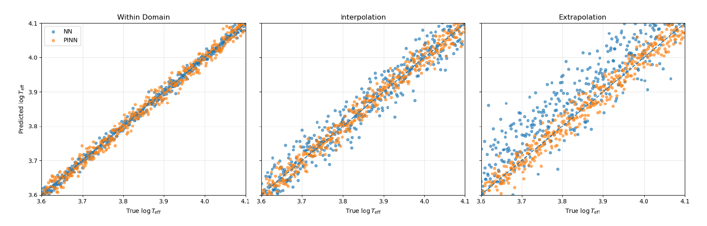
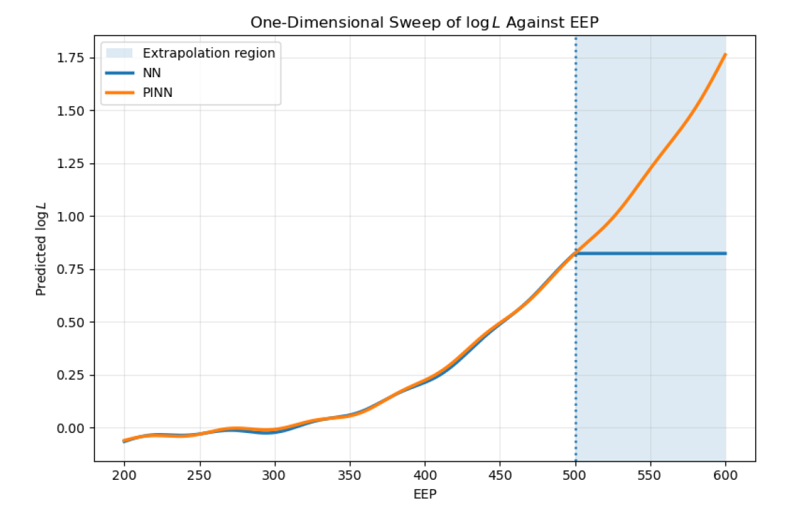

# A Comparative Study of Neural Networks and Physics-Informed Neural Networks for Stellar Property Modelling

**MSci Physics Dissertation | University of Birmingham | April 2026**

**Author:** Shayan Zebarjadnam  
**Supervisor:** Dr Guy Davies

## Overview

This research investigates whether incorporating physical constraints into neural-network training improves predictive accuracy, generalisation and physical consistency when modelling stellar properties.

A standard neural network (NN) and a physics-informed neural network (PINN) were systematically compared using two simulated stellar-evolution datasets across three evaluation regimes: within-domain prediction, interpolation across missing data regions, and extrapolation beyond the training domain.

## Methodology

- Developed and trained NN and PINN models using Python and PyTorch
- Implemented identical neural-network architectures to enable controlled comparisons
- Incorporated a physics-inspired, curvature-based smoothness constraint into the PINN loss function
- Applied backpropagation, Adam optimisation and scheduled loss weighting
- Evaluated model performance using RMSE, MAE, R², smoothness metrics and visual diagnostics
- Investigated model generalisation across different data-availability conditions

## Key Findings

### Predictive Accuracy

| Evaluation Regime | NN RMSE | PINN RMSE | Result |
|---|---|---|---|
| Within-domain | 0.10% | 0.12% | NN performs slightly better |
| Interpolation | 0.36% | 0.25% | **31% lower RMSE with PINN** |
| Extrapolation | 0.82% | 0.34% | **59% lower RMSE with PINN** |

### Physical Consistency

The PINN also demonstrated improved prediction smoothness:

- **48% lower second-difference metric** (0.029 vs 0.015), indicating reduced curvature variation
- Smoother, more physically consistent predictions in sparse and unseen regions
- Improved generalisation despite a small reduction in within-domain predictive accuracy

## Visual Results

### Figure 1 — Predicted vs True Values

Comparison of NN and PINN predictions across within-domain, interpolation and extrapolation regimes. The PINN demonstrates improved predictive accuracy in sparse and unseen data regions.

### Figure 3 — Extrapolation Behaviour

One-dimensional input sweep comparing predicted stellar luminosity against evolutionary stage. Outside the training domain, the standard NN tends towards simplified predictions, while the PINN maintains smoother, nonlinear behaviour consistent with expected physical trends.

## Research Significance

The findings demonstrate that strong predictive accuracy on familiar data does not necessarily translate into reliable generalisation under unfamiliar conditions.

Incorporating appropriate prior physical knowledge into the training objective improved the models' ability to generalise while constraining physically implausible behaviour.

The study highlights the importance of rigorous empirical evaluation, understanding model limitations and balancing predictive accuracy with physical consistency.

## Full Dissertation

**[Read the full MSci Physics dissertation (PDF)](Shayan_Zebarjadnam_MSci_Dissertation.pdf)**

The full report includes the theoretical background, experimental methodology, quantitative results, figures, discussion, limitations and conclusions.

## Source Code

The original implementation is no longer accessible and is therefore not included in this repository.
